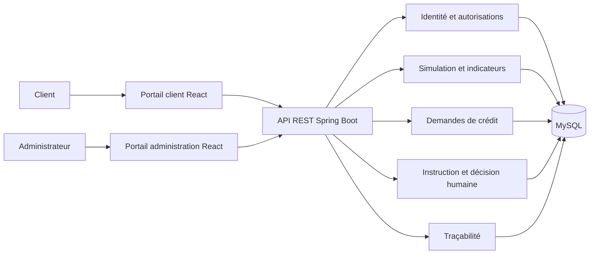

# Architecture fonctionnelle — BNA Digital Banking

## 1. Objectif et périmètre

Cette architecture sert de base au développement du prototype académique BNA Digital Banking. L'application permet à un client de préparer et suivre une demande de crédit fictive ; un administrateur instruit cette demande et enregistre une décision humaine.

Le prototype ne se connecte pas à un système bancaire réel, ne gère pas de fonds et ne prend aucune décision de crédit de façon automatisée. Les simulations et indicateurs d'éligibilité sont informatifs et doivent être présentés comme tels.

## 2. Acteurs et espaces

| Acteur | Espace | Responsabilités |
| --- | --- | --- |
| Visiteur | Portail client | Créer un compte et se connecter. |
| Client authentifié | Portail client | Compléter son profil, simuler un crédit, déposer une demande, fournir des pièces et suivre son statut. |
| Administrateur | Portail d'administration | Consulter les demandes, examiner les informations, demander un complément et enregistrer une décision motivée. |

Les rôles sont `CLIENT` et `ADMIN`. Un client ne peut accéder qu'à ses propres données et demandes. Les fonctions d'administration sont réservées aux administrateurs.

## 3. Domaines fonctionnels

1. **Identité et accès** — inscription, connexion, profil et contrôle des rôles.
2. **Comptes fictifs** — comptes courant et épargne de démonstration, soldes et opérations du client.
3. **Self-budgeting** — suivi mensuel des revenus/dépenses et objectifs personnels par catégorie.
4. **Simulation de crédit** — calcul indicatif d'une mensualité à partir du montant, de la durée et d'hypothèses de taux clairement affichées.
5. **Demandes de crédit** — création à partir d'une simulation, soumission et suivi du cycle de vie.
6. **Instruction** — consultation par l'administration, analyse d'indicateurs et gestion des demandes de pièces complémentaires.
7. **Décision humaine** — approbation ou refus explicite par un administrateur, avec motif et date.
8. **Traçabilité** — journalisation des changements de statut et des décisions importantes.
9. **Scoring Java de démonstration** — conserver une évaluation explicable fondée sur l'instantané de simulation et les déclarations facultatives du client. Cette aide est indépendante de la décision administrative.

Les comptes et transactions sont entièrement fictifs et ne se connectent à aucune banque réelle. L'analyse IA externe est une aide indépendante, déclenchée par l'administrateur, et ne décide jamais à sa place.

## 4. Parcours principaux

### 4.1 Parcours client

1. Le visiteur crée un compte ou se connecte.
2. Le client complète les informations de profil requises.
3. Il saisit les paramètres de simulation ; l'application affiche une estimation non contractuelle.
4. Il démarre une demande à partir de cette simulation et complète les informations demandées.
5. Il soumet la demande et reçoit son numéro de référence.
6. Il consulte le statut et les éventuelles demandes de complément.
7. Il fournit les éléments demandés et suit l'évolution jusqu'à la décision.

### 4.2 Parcours administrateur

1. L'administrateur se connecte et consulte la file des demandes soumises.
2. Il ouvre une demande et examine le profil, les paramètres déclarés et les pièces disponibles.
3. Il peut demander des informations complémentaires ; la demande repasse alors au client.
4. Il enregistre une décision d'approbation ou de refus, obligatoirement accompagnée d'un motif.
5. Le système trace l'auteur, la date et le changement de statut ; le client peut consulter le résultat.

## 5. Cycle de vie d'une demande

```text
DRAFT -> SUBMITTED -> UNDER_REVIEW -> APPROVED
                                |----> REJECTED
                                |----> ADDITIONAL_INFO_REQUIRED -> SUBMITTED

DRAFT -> WITHDRAWN
SUBMITTED / UNDER_REVIEW -> WITHDRAWN (selon les règles retenues pour le prototype)
```

- `DRAFT` : modifiable par son propriétaire, non visible dans la file de traitement.
- `SUBMITTED` : envoyée par le client ; les champs de demande sont verrouillés hors complément demandé.
- `UNDER_REVIEW` : prise en charge par l'administration.
- `ADDITIONAL_INFO_REQUIRED` : l'administrateur a demandé un complément ; action attendue du client.
- `APPROVED` / `REJECTED` : décision finale enregistrée par un administrateur avec un motif.
- `WITHDRAWN` : demande retirée avant décision finale.

Les transitions doivent être validées côté serveur. Une simulation ou un score ne peut pas faire passer automatiquement une demande à `APPROVED` ou `REJECTED`.

## 6. Vue fonctionnelle des composants



Les deux interfaces React restent des clients distincts de la même API. Les règles métier, contrôles d'accès et changements d'état sont appliqués dans le backend, jamais uniquement dans l'interface.

## 7. Données métier principales

| Entité | Données essentielles | Relations |
| --- | --- | --- |
| `User` | Identifiant, nom, email unique, mot de passe haché, rôle, date de création | Un client possède un profil et plusieurs demandes. |
| `CustomerProfile` | Coordonnées et informations déclaratives nécessaires au prototype | Appartient à un `User`. Collecter uniquement les champs réellement utiles. |
| `CreditSimulation` | Type de crédit, montant, durée, taux hypothétique, mensualité estimée, date | Appartient à un client ; peut servir de base à une demande. |
| `CreditApplication` | Référence, client, type, montant, durée, statut, dates de soumission et de mise à jour | Appartient à un client ; peut référencer une simulation et posséder des pièces et événements. |
| `ApplicationDocument` | Nom logique, type, état de dépôt et métadonnées de stockage | Appartient à une demande. Ne pas stocker de contenu sensible dans les journaux. |
| `ApplicationEvent` | Demande, ancien/nouveau statut, auteur, date, motif ou commentaire | Historique append-only des actions métier importantes. |
| `CreditDecision` | Décision, motif, administrateur auteur, date | Une décision finale au plus par demande. |
| `BankAccount` | Référence, propriétaire, type, solde initial et courant, devise | Appartient à un `User`; chaque client dispose d'un compte courant et d'un compte épargne fictifs. |
| `AccountTransaction` | Référence, compte, type, catégorie, montant positif, date, description, référence de virement | Appartient à un `BankAccount`; opérations conservées sans édition ni suppression. |
| `MonthlyBudget` | Propriétaire, mois, catégorie de dépense, limite mensuelle | Objectif personnel unique par client/mois/catégorie. |

Les simulations doivent utiliser des montants décimaux (`DECIMAL` / `BigDecimal`), jamais des nombres flottants pour les calculs monétaires. Les taux et hypothèses sont visibles à l'utilisateur et centralisés/configurables côté serveur.

### 7.1 Scoring Java de démonstration

À la soumission d'une demande éligible, le backend crée et persiste une évaluation dans `credit_scoring_evaluations` et ses facteurs dans `credit_scoring_factors`. Elle est associée à l'instantané de simulation enregistré pour cette demande et conservée indépendamment de toute décision humaine.

| Facteur | Poids maximal | Base de calcul |
| --- | ---: | --- |
| Endettement | 25 | Points linéaires décroissants selon le taux d'endettement calculé après la mensualité demandée. |
| Revenu disponible | 20 | Part du revenu retenu restant après mensualité, plafonnée selon la configuration de démonstration. |
| Stabilité des revenus | 34 | Nombre de mois consécutifs avec une opération `SALARY` observée, plafonné au nombre de mois configuré. |
| Régularité de l'épargne | 21 | Nombre de mois avec un virement interne entrant observé sur le compte épargne au cours des 12 derniers mois. |

Le critère d'historique de remboursement synthétique a été retiré : aucun retard n'est généré ou intégré au score. Au démarrage, les évaluations persistées sont recalculées avec les poids et facteurs courants. Les poids des quatre critères restants totalisent 100. Les facteurs financiers sont calculés côté serveur à partir de la simulation. La stabilité et l'épargne sont dérivées des transactions fictives effectivement enregistrées dans l'application ; l'absence d'observations est conservée comme donnée manquante et ne devient pas zéro. Le score est calculé sur 100 à partir des poids disponibles et signalé comme provisoire tant qu'un facteur manque. Les seuils d'affichage sont faible (75–100), modéré (50–74,99) et élevé (0–49,99). Il s'agit uniquement d'un barème académique fictif, non d'une règle officielle BNA. Le score ne constitue ni une éligibilité bancaire ni une décision d'octroi ; accepter ou refuser reste une action humaine de l'administrateur.

Les paramètres modifiables du barème de démonstration sont `SCORING_AVAILABLE_INCOME_FULL_SCORE_RATIO` (défaut 0,30), `SCORING_INCOME_STABILITY_FULL_SCORE_MONTHS` (24) et `SCORING_SAVINGS_FULL_SCORE_MONTHS` (12).

### 7.2 Analyse IA et comparaison indépendante

Pendant l'instruction (`UNDER_REVIEW`), un administrateur peut déclencher ou relancer l'analyse IA. Le backend envoie uniquement les faits métier nécessaires à l'évaluation (scénario, montant et durée demandés, valeurs financières de la simulation et déclarations facultatives). Le contrat transmis au fournisseur n'inclut ni nom, ni email, ni référence de demande, ni CIN, ni numéro de compte ou identifiant client. Le service demande un JSON contenant `eligibility_status`, `risk_level`, `reasons`, `missing_information` et `warnings` ; le backend valide strictement ces champs avant persistance.

L'adaptateur appelle directement l'API Gemini native `models/{model}:generateContent` ; il n'utilise pas l'API OpenAI ni son format. Il est désactivé par défaut ; les variables `LLM_ENABLED`, `LLM_BASE_URL`, `LLM_MODEL`, `LLM_API_KEY`, `LLM_CONNECT_TIMEOUT` et `LLM_READ_TIMEOUT` le configurent. Si l'intégration est désactivée ou indisponible, l'évaluation est enregistrée avec un statut explicite et le score Java demeure inchangé. Une réponse invalide est également marquée comme telle. Les résultats Java et IA, ainsi que leurs comparaisons d'éligibilité et de risque, restent indépendants. L'IA ne calcule pas le montant maximal officiel et aucune divergence ou convergence ne déclenche une décision ; l'administrateur reste seul responsable de la décision humaine motivée.

## 8. API REST proposée pour le MVP

Toutes les routes métier sont préfixées par `/api`. Les routes de santé et de documentation restent publiques ; les autres requièrent une authentification.

| Méthode | Route | Accès | Fonction |
| --- | --- | --- | --- |
| `POST` | `/auth/register` | Public | Créer un compte client. |
| `POST` | `/auth/login` | Public | Ouvrir une session et obtenir le jeton d'accès. |
| `GET` | `/users/me` | Client | Lire son profil. |
| `PUT` | `/users/me` | Client | Mettre à jour son profil. |
| `POST` | `/simulations/sans-rachat` | Client | Calculer une simulation sans rachat. |
| `POST` | `/simulations/rachat-interne` | Client | Calculer un rachat interne. |
| `POST` | `/simulations/rachat-externe` | Client | Calculer un rachat externe. |
| `GET` | `/simulations/catalogue?scenario=...` | Client | Obtenir les types de crédit et durées configurés. |
| `GET` | `/admin/parameters` | Admin | Consulter le TMM et les marges. |
| `PUT` | `/admin/parameters/tmm` | Admin | Mettre à jour le TMM. |
| `PUT` | `/admin/parameters/margins` | Admin | Créer ou mettre à jour une marge et sa durée maximale. |
| `GET` | `/accounts` | Client | Lire ses comptes fictifs (créés au premier accès). |
| `GET` | `/accounts/categories` | Client | Obtenir les catégories fixes de revenus et de dépenses. |
| `GET` | `/accounts/{id}/transactions` | Propriétaire | Lire les opérations d'un compte lui appartenant. |
| `POST` | `/accounts/{id}/transactions` | Propriétaire | Enregistrer un revenu ou une dépense fictifs et catégorisés. |
| `POST` | `/accounts/transfers` | Client | Effectuer un virement fictif entre deux comptes lui appartenant. |
| `GET` | `/budget?month=AAAA-MM` | Client | Lire les revenus, dépenses et limites budgétaires du mois. |
| `PUT` | `/budget` | Client | Créer ou modifier un objectif mensuel par catégorie. |
| `POST` | `/applications` | Client | Créer un brouillon, éventuellement depuis une simulation. |
| `GET` | `/applications` | Client | Lister ses demandes. |
| `GET` | `/applications/{id}` | Propriétaire / Admin | Consulter une demande autorisée. |
| `PUT` | `/applications/{id}` | Propriétaire, brouillon seulement | Mettre à jour une demande. |
| `POST` | `/applications/{id}/submit` | Propriétaire | Soumettre la demande. |
| `POST` | `/applications/{id}/provide-info` | Propriétaire, complément demandé | Transmettre un complément textuel. |
| `POST` | `/applications/{id}/withdraw` | Propriétaire, avant décision | Retirer la demande. |
| `GET` | `/admin/applications` | Admin | Consulter et filtrer la file de traitement. |
| `POST` | `/admin/applications/{id}/claim` | Admin | Marquer la demande comme prise en charge. |
| `POST` | `/admin/applications/{id}/request-info` | Admin | Demander un complément motivé. |
| `POST` | `/admin/applications/{id}/decision` | Admin | Enregistrer une approbation ou un refus motivé. |
| `POST` | `/admin/applications/{id}/ai-evaluation` | Admin, demande en examen | Déclencher l'analyse IA et enregistrer le résultat indépendant et la comparaison avec Java. |

Les demandes stockent les données déclarées nécessaires à l'instruction et un historique des actions avec auteur, rôle, date, ancien/nouveau statut et commentaire. Les pièces justificatives ne sont pas incluses dans ce premier périmètre. La liste d'administration est consultable par statut avec le paramètre facultatif `?status=SUBMITTED` ; les demandes sont retournées dans l'ordre de mise à jour, sans pagination dans ce MVP. Le produit et la durée sont revalidés contre le catalogue configuré au moment de la création ou de la modification du brouillon.

Les contrôles d'accès doivent vérifier à la fois le rôle et la propriété de la ressource. Une route non autorisée ne doit jamais exposer l'existence ou les détails d'une demande d'un autre client.

Les simulations seules restent des calculs immédiats non persistés. Lorsqu'un brouillon de demande est explicitement créé, ses données déclarées et un instantané des principaux résultats calculés par le backend sont enregistrés avec la demande. Au moment de la soumission, le backend recalcule et refuse toute demande sans montant positif ou dont le scénario est inéligible, dépasse la capacité disponible ou ne respecte plus la durée maximale configurée. Le TMM et les marges fournis par le paramétrage initial sont amorcés une seule fois dans la base ; les mises à jour administrateur ne sont pas écrasées au redémarrage. Les montants de résultat sont arrondis à deux décimales avec `HALF_UP`.

Les comptes de démonstration sont initialisés à 2 000 DT (courant) et 5 000 DT (épargne), réglables par `DEMO_CURRENT_ACCOUNT_BALANCE` et `DEMO_SAVINGS_ACCOUNT_BALANCE`. Les opérations ne sont ni modifiables ni supprimables ; une dépense ou un virement est refusé si le solde fictif disponible est insuffisant. Les virements internes produisent deux écritures liées, exclues des revenus et dépenses du budget. Les limites budgétaires signalent les dépassements sans bloquer l'enregistrement d'une dépense.

## 9. Organisation de code par domaine

Le code est organisé par **partie fonctionnelle**. Chaque domaine garde ses éléments ensemble ; le suivi « déjà développé / à développer » est un inventaire documentaire, pas des dossiers qui contiendraient du code non compilé.

### Backend Spring Boot — structure cible

```text
com.bna.digitalbanking
  identity/                         # gestion des utilisateurs et authentification existante
  simulation/                       # simulations et paramètres existants
  account/
    entity/ repository/ service/ controller/ dto/ # comptes, opérations et virements fictifs
  budget/
    entity/ repository/ service/ controller/ dto/ # budgets mensuels par catégorie
  credit/
    application/
      entity/                       # demande, statut, historique et instantané
      repository/                   # accès aux demandes et événements
      service/                      # cas d'usage et transitions métier
      controller/                   # API client et API admin
      dto/                          # contrats d'entrée/sortie
    scoring/                        # évaluations Java explicables et persistées
    ai/                             # à développer ultérieurement
    decision/                       # décision humaine, à approfondir
  common/
  SecurityConfig.java
```

Pour éviter une réécriture risquée, `identity/` et `simulation/` conservent pour le moment leur organisation existante. Les nouveaux domaines suivent directement la séparation par couches ; l'organisation des anciens domaines pourra évoluer de manière incrémentale.

### Frontend — application commune organisée par fonctionnalités

Le portail commun est hébergé dans `frontend-client/` pour préserver le projet Vite déjà fonctionnel. Le rôle renvoyé par l'API sélectionne l’espace client ou admin ; les deux espaces partagent cette application.

```text
frontend-client/src/
  app/                              # application, navigation, espace selon le rôle
  features/
    accounts/                       # comptes, opérations, virements et self-budgeting
    simulation/                     # parcours client et formulaires
    applications/                   # confirmation, suivi, historique de crédit
    scoring/                        # visualisation explicable de l'indicateur
    admin/                          # paramètres et fonctions d'administration
  shared/                           # composants, styles et services communs
```

Les composants client sont classés par fonctionnalité dans `features/simulation/` et `features/applications/`, et l’administration dans `features/admin/`. Les deux origines ne partagent pas leur stockage local ; l’ancien port admin redirige vers le port du portail commun avant toute authentification.

### État des domaines

| Domaine | État | Réutilisable / reste à faire |
| --- | --- | --- |
| Gestion des utilisateurs | Déjà développé côté backend | Inscription client, connexion JWT, rôles `CLIENT`/`ADMIN`. Connexion commune et navigation par rôle restent à intégrer au frontend. |
| Simulation | Déjà développé | Trois calculs backend, paramètres et catalogue. Les seuils codés sont des règles du prototype, pas des règles bancaires officielles. |
| Demande de crédit | Développé pour le parcours de base | Demande persistée, instantané de simulation, historique, parcours frontend client, administration et décision humaine. |
| Comptes fictifs | Développé | Comptes courant/épargne initialisés à la première consultation, opérations catégorisées et virements internes avec contrôle de solde et de propriété. |
| Self-budgeting | Développé | Synthèse mensuelle à partir des opérations, limites par catégorie et alertes de dépassement non bloquantes. |
| Scoring Java | Développé pour le prototype | Score déterministe pondéré, persistant et explicable ; données client facultatives ; score partiel marqué provisoire. Barème académique configurable, non officiel et non décisionnel. |
| Analyse IA et comparaison | Développé pour le prototype | Adaptateur OpenAI-compatible désactivé par défaut, faits sans identité, JSON validé, états explicites et comparaison indépendante ; aucun effet décisionnel. |

## 10. Sécurité, confidentialité et règles non négociables

- Remplacer l'autorisation actuelle de toutes les routes par des règles explicites ; protéger les routes métier par rôle.
- Hacher les mots de passe avec un algorithme adapté (par exemple BCrypt) ; ne jamais les renvoyer dans l'API.
- Valider les entrées côté serveur et limiter l'accès aux ressources au propriétaire ou à un administrateur.
- Ne jamais inclure de justificatifs, mots de passe ou données personnelles complètes dans les logs.
- Limiter les données collectées et les documents au strict besoin du prototype ; utiliser des données fictives pour les démonstrations.
- Exiger un motif pour les décisions et conserver un historique des actions.
- Afficher clairement que les montants, taux, indicateurs et résultats de démonstration ne constituent ni une offre bancaire ni une décision automatisée.

## 11. Ordre conseillé pour commencer le codage

1. Poser les statuts, DTO, validations et format d'erreur API ; ajouter les tests de transitions.
2. Implémenter inscription, connexion, rôles `CLIENT`/`ADMIN` et tests d'accès/ownership avant d'exposer des données métier.
3. Construire le profil client et les écrans de connexion des deux portails.
4. Implémenter le calcul de simulation déterministe et ses tests (montant, durée, taux, arrondis).
5. Ajouter le brouillon, la soumission, la liste et le suivi des demandes.
6. Ajouter la file d'instruction, les demandes de complément et la décision humaine avec historique.
7. Ajouter le dépôt de documents avec limites de taille/type et stockage adapté ; ne pas commencer par le stockage de justificatifs réels.
8. Évaluer ensuite les comptes fictifs, transactions ou une analyse assistée, sans déplacer la décision finale hors du rôle humain.

Le premier parcours vertical à livrer est : **inscription/connexion → simulation → soumission d'une demande → instruction admin → décision motivée visible par le client**.
